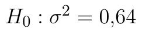
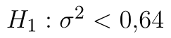
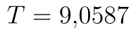
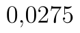

## Levostranný jednovýběrový test na rozptyl

V článku si vysvětlíme, jak bychom provedli levostranný test, tentokrát již bez slovního zadání. Důvodem je, abychom si ukázali chování funkcí pro  při levostranném testu. 

V případě levostranného testu budeme mít následující hypotézy:

* Nulová hypotéza: Rozptyl je 0,64. ()
* Alternativní hypotéza: Rozptyl je menší než 0,64. ()

Soubor s daty a výpočty naleznete [zde](assets/chi-kvadrat-test-rozptyl-levostranny_test-rozptyl.xlsx)

## Výpočet v Excelu

Pro určení hranice kritického oboru u levostranného testu je výhodnější standardní kvantilová funkce CHISQ.INV:

```text
=CHISQ.INV(D5;D2-1)
```

Python alternativa:

```python
from scipy.stats import chi2

critical_value = chi2.ppf(alpha, df=n - 1)
```

Protože rozdělení  nabývá pouze kladných hodnot, kritický obor zapsaný intervalem je:

::fig[]{src=assets/formula-block-bb3e7a4217d7.png}

Hodnota statistiky  leží v kritickém oboru, proto na dané hladině významnosti zamítáme nulovou hypotézu.

Vzorec pro výpočet p-hodnoty testu je u standardní distribuční funkce opět jednoduchý:

```text
=CHISQ.DIST(D8;D2-1;TRUE)
```

Python alternativa:

```python
from scipy.stats import chi2

p_value = chi2.cdf(statistic, df=n - 1)
```

U pravostranné distribuční funkce je opět třeba odečíst výslednou hodnotu od jedničky.

```text
=1-CHISQ.DIST.RT(D8;D2-1)
```

Python alternativa:

```python
from scipy.stats import chi2

p_value = chi2.cdf(statistic, df=n - 1)
```

Správně vidíme, že p-hodnota  je nižší než hladina významnosti, což potvrzuje náš předchozí závěr o zamítnutí nulové hypotézy.
