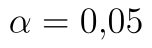
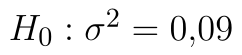
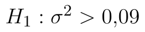
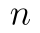
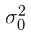
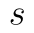
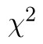
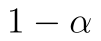
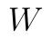
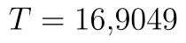

## Jednovýběrový test na rozptyl

[Rozptyl](rozptyl.md) je ukazatelem variability. Ukazažele variability jsou měřítkem toho, nakolik jsou hodnoty souboru vzájemně různorodé. Chí-kvadrát test o rozptylu umožňuje ověřit hypotézu o rozptylu dat.

Uvažujeme následující příklad: *Máme zařízení, pomocí kterého vyrábíme součástky průměrné délky 190 mm. Výrobce garantuje, že maximální rozptyl délky součástky je 0,09 mm. Ověřte na hladině významnosti , zda rozptyl délky překračuje hranici zadanou výrobcem.*

Dle zadání bychom měli provést jednostranný (pravostranný) test. Reálné příklady oboustranného testu by se hledaly poměrně složitě. Většinou požadujeme větší nebo naopak menší variabilitu, než je daná hranice.

Formulujme nejprve hypotézy testu:

* Nulová hypotéza: Rozptyl délky je 0,09. ()
* Alternativní hypotéza: Rozptyl délky je větší než 0,09. ()

## Výpočet v Excelu

Statistiku testu vypočteme ze vztahu

::fig[]{src=assets/formula-block-b289166f0b00.png}

kde  je rozsah výběru,  je teoretický (testovaný, hypotetický) rozptyl a  je [výběrový rozptyl](rozptyl.md). Statistika je tedy poměrem teoretického a výběrového rozptylu, kterou násobíme rozsahem výběru. Jestliže je tedy například výběrový rozptyl výrazně větší než teoretický, má statistika relativně vysokou hodnotu. Naopak relativně nízké hodnoty svědčí o výrazně menším výběrovém rozptylu ve srovnání s teoretickým.

Statistika má  rozdělení. Toto rozdělení má jeden parametr, který nazýváme počet stupňů volnosti. Stupeň volnosti se rovná **počtu pozorování sníženému o jedničku**. Kritický obor tedy určíme pomocí kvantilů  jako

::fig[]{src=assets/formula-block-9553e1d4582a.png}

Soubor s daty a výpočty naleznete [zde](assets/chi-kvadrat-test-rozptyl_test-rozptyl.xlsx)

Nejprve určíme výběrový rozptyl. K tomu využijeme funkci VAR.S:

```text
=VAR.S(A1:A20)
```

Python alternativa:

```python
import numpy as np

sample_variance = np.var(sample, ddof=1)
```

Pro určení **kritického oboru** máme dvě možnosti. Můžeme využít standardní kvantilovou funkci pro  rozdělení `CHISQ.INV`. Protože ale část rozdělení odpovídající hladině významnosti "odsekáváme" zprava, jako kvantil zadáváme . Jako druhý parametr zadáváme počet stupňů volnosti. Vzorec pro výpočet je tedy

```text
=CHISQ.INV(1-D5;D2-1)
```

Python alternativa:

```python
from scipy.stats import chi2

critical_value = chi2.ppf(1 - alpha, df=n - 1)
```

Alternativně je možné využít funkci `CHISQ.INV.RT`. Jedná se o **pravostrannou kvantilovou funkci**  rozdělení, tj. již samotná funkce určuje z námi zadaného kvantilu jednotkový doplněk a tento kvantil standardního rozdělení pak vrací. Hranici kritického oboru tedy určíme vzorcem

```text
=CHISQ.INV.RT(D5;D2-1)
```

Python alternativa:

```python
from scipy.stats import chi2

critical_value = chi2.isf(alpha, df=n - 1)
```

Chceme-li zapsat hodnotu kritického oboru  intervalem, pak napíšeme:

::fig[]{src=assets/formula-block-8ec6b450f9ab.png}

Hodnotu statistiky vypočteme jednoduše vzorcem

```text
=(D2-1)*E3/D4
```

Python alternativa:

```python
statistic = (n - 1) * sample_variance / sigma0_squared
```

Hodnota statistiky je , neleží tedy v kritickém oboru a tím pádem na dané hladině významnosti nulovou hypotézu nezamítáme.

## Určení p-hodnoty

K určení p-hodnoty máme opět k dispozici dvojici funkcí - `CHISQ.DIST` a `CHISQ.DIST.RT`. První je standardní distribuční funkcí  rozdělení, druhá funkce je pravostrannou distribuční funkcí  rozdělení. Tato funkce vrací plochu pod hustotou rozdělení napravo od zadané hodnoty. Jinak řečeno, vrací rozdíl mezi jedničkou a hodnotou distribuční funkce pro zadanou hodnotu.

Při využití funkce `CHISQ.DIST` musíme sami dopočítat doplněk hodnoty do jedničky, protože počítáme pravostranný test a p-hodnota se určuje jako plocha pod hustotou od hodnoty statistiky směrem napravo. Jako poslední parametr zadáváme PRAVDA, protože chceme hodnotu distribuční funkce, při zadání NEPRAVDA bychom získali hodnotu hustoty pravděpodobnosti. Správný vzorec tedy je:

```text
=1-CHISQ.DIST(D8;D2-1;PRAVDA)
```

Python alternativa:

```python
from scipy.stats import chi2

p_value = chi2.sf(statistic, df=n - 1)
```

V případě pravostranné distribuční funkce žádnou úpravu již neprovádíme:

```text
=CHISQ.DIST.RT(D8;D2-1)
```

Python alternativa:

```python
from scipy.stats import chi2

p_value = chi2.sf(statistic, df=n - 1)
```

::fig[]{src=assets/chi-kvadrat-test-rozptyl_test-rozptyl-data-a-vysledky.png}
