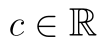
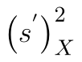
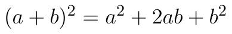
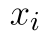
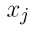
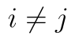
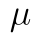
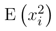

## Rozptyl podruhé

V popisu [výběrového rozptylu](rozptyl.md) chybí důkaz nebo jakékoli vysvětlení, proč je zavedení výběrového rozptylu vlastně potřeba a proč vzorec na rozptyl nelze použít pro nestranný odhad. Tomu se budeme věnovat nyní. 

Nejprve si odvodíme takzvaný **výpočetní tvar pro rozptyl**. Víme, že populační rozptyl se spočte pomocí vztahu

::fig[]{src=assets/formula-block-5734bd191eee.png}

Pro výpočet hodnoty rozptylu pomocí kalkulačky je tento vzorec poměrně nepraktický, protože pro každou hodnotu souboru je potřeba zadat rozdíl mezi danou hodnotou a střední hodnotou. Můžeme ale provést následující úpravy:

::fig[]{src=assets/formula-block-a2daad2fd3c9.png}

Výsledný výpočetní tvar pro rozptyl má tvar

::fig[]{src=assets/formula-block-1fb6dc39e0d5.png}

Stačí tedy vypočítat součet druhých mocnin hodnot souboru a odečíst od něj druhou mocninu součtu hodnot, což rychlost výpočtu podstatně sníží. Tento vztah ještě využijeme níže.

Nyní se ale vraťme k výběrovému rozptylu. Jestliže máme k dispozici pouze náhodný výběr z nějakého souboru (a nikoli všechny hodnoty souboru), zpravidla **nebudeme znát střední hodnotu** základního souboru. Tuto střední hodnotu musíme **odhadnout pomocí aritmetického průměru**. Dokažme si nejprve, že aritmetický průměr je **nezkresleným odhadem** střední hodnoty, tj. určíme si střední hodnotu aritmetického průměru:

::fig[]{src=assets/formula-block-d4c3a7e12f4f.png}

Využíváme dvou známých vlastností střední hodnoty. Při násobení náhodné veličiny konstantou  platí, že

::fig[]{src=assets/formula-block-0279b0759d2e.png}

A dále střední hodnota součtu náhodných veličin se rovná součtu středních hodnot náhodných veličin:

::fig[]{src=assets/formula-block-6990a924e0e7.png}

Střední hodnota aritmetického průměru je tedy skutečně střední hodnotou náhodného výběru, tím pádem je dokázáno, že takový odhad je **nezkreslený**. Vraťme se nyní ke vzorci pro populační rozptyl:

::fig[]{src=assets/formula-block-006f88a19493.png}

Namísto střední hodnoty nyní do vzorce dosadíme aritmetický průměr. Takto upravenou statistiku si označíme jako :

::fig[]{src=assets/formula-block-ffd0ff714983.png}

Nyní použijeme známý vzorec  a provedeme několik jednoduchých úprav.

::fig[]{src=assets/formula-block-9a8e76b6d0fe.png}

V případě druhého sčítance na posledním řádku provádíme součet vzájemných násobků hodnot v náhodném výběru. Výraz lze zapsat též jako

::fig[]{src=assets/formula-block-a203f61525f6.png}

protože rozlišujeme mezi případy, kdy jsou mezi sebou násobeny dva různé náhodné výběry, a kdy je násobena tatáž realizace náhodného výběru. Tím jsme získali upravený vzorec pro statistiku :

::fig[]{src=assets/formula-block-31e29cbaa98f.png}

Abychom si ukázali, jak je statistika  zkresleným odhadem rozptylu, určíme si její střední hodnotu:

::fig[]{src=assets/formula-block-9c5e791790cd.png}

Uvažujeme, že jednotlivé realizace náhodného výběru jsou vzájemně nezávislé, tj. hodnoty  a  jsou pro  nezávislé. V tom případě pak platí vztah

::fig[]{src=assets/formula-block-ebad1a14e12a.png}

Protože se ale v obou případech jedná o náhodný výběr ze stejného souboru se střední hodnotou , platí dokonce

::fig[]{src=assets/formula-block-29bf1f48ba54.png}

Dále máme v rovnici výraz . Upravíme-li si rovnici pro výpočetní tvar rozptylu, kterou jsme odvodili výše, zjistíme, že

::fig[]{src=assets/formula-block-18af23ddda28.png}

Dosaďme tedy za oba výrazy a pokračuje v odvození

::fig[]{src=assets/formula-block-3bddfe4f53d3.png}

Vidíme tedy, že střední hodnota statistiky  je

::fig[]{src=assets/formula-block-45af8c8944dc.png}

Abychom tedy získali nezkreslený odhad rozptylu, museli bychom statistiku  násobit výrazem . Na základě této myšlenky je pak odvozen vzorec pro výběrový rozptyl. Výraz  je někdy nazýván jako [Besselova korekce](https://en.wikipedia.org/wiki/Bessel%27s_correction). Výraz  konverguje k 1, pro velmi velké náhodné výběry je rozdíl mezi statistikami zanedbatelný. Protože střední hodnota statistiky  konverguje k hodnotě rozptylu, je **asymptoticky nestranným odhadem rozptylu**.
