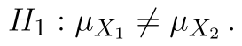
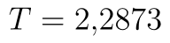
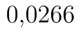
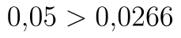
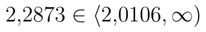

## Dvouvýběrový oboustranný t-test

Poslední variantou je oboustranný test. Opět si upravíme zadání příkladu: *Máme data o počtu vyrobených výrobků pracovníky za jednu směnu ve dvou různých závodech jedné společnosti. Ověřte na  hypotézu, že mezi těmito dvěma závody existuje statisticky významný rozdíl v průměrném počtu vyrobených výrobků.*

V tomto případě se v zadání nepřikláníme na jednu ani na druhou stranu, tj. alternativní hypotéza platí jak v případě, že první závod bude v průměru lepší, tak i v případě, že bude v průměru horší.

Hypotézy našeho testu jsou následující:

*  (Střední hodnota obou souborů je stejná.)
*  (Střední hodnota souborů se liší.)

Vzorec pro výpočet statistiky zůstává stejný, kritický obor se (jako v případě předchozích oboustranných testů) skládá z dvou intervalů:

::fig[]{src=assets/formula-block-f10071fae8eb.png}

List s daty je na obrázku níže.

::fig[]{src=assets/t-test-dvouvyberovy-oboustranny_dvouvc3bdbc49brovc3bd-t-test-oboustrannc3bd-data.png}

Soubor se všemi výpočty naleznete [zde](assets/t-test-dvouvyberovy-oboustranny_dvouvyberovy_t-test.xlsx).

Všimněte si, že rozsah obou souborů je stejný, vzhledem k charakteru dat ale nelze použít párový t-test.

## Výpočet s využitím doplňku Analýza dat

Výpočet spustíme obdobným postupem jako výše.

::fig[]{src=assets/t-test-dvouvyberovy-oboustranny_dvouvc3bdbc49brovc3bd-t-test-oboustrannc3bd-analc3bdza-dat.png}

Níže vidíme výsledky. Hodnotu testové statistiky nalezneme stále na stejném místě, tj. . Dále nás budou zajímat poslední dva řádky. Poslední řádek obsahuje hranici kritického oboru, resp. jeho horní hranici. Dolní hranice je v absolutní hodnotě stejná jako horní, je však záporná, neboť Studentovo rozdělení je symetrické.

::fig[]{src=assets/t-test-dvouvyberovy-oboustranny_dvouvc3bdbc49brovc3bd-t-test-oboustrannc3bd-analc3bdza-dat-2.png}

Kritický obor tedy je

::fig[]{src=assets/formula-block-bcde81eac9e9.png}

V předposledním řádku je p-hodnota. Ta je v případě oboustranného testu vždy správná, tj. p-hodnota našeho testu je . Za tabulky vidíme, že

* p-hodnota je menší než hladina významnosti (),
* hodnota statistiky se nachází v kritickém oboru (),

zamítáme tedy nulovou hypotézu. Na hladině významnosti  jsme tedy prokázali, že mezi oběma závody existuje rozdíl. Nemůžeme však tvrdit, že by první závod byl lepší než druhý, pouze existenci rozdílu!

## Využití funkce T.TEST

V případě oboustranného testu je použití funkce T.TEST jednoduché. Jako poslední parametr zadáváme 2. Vrácená p-hodnota je vždy správná bez ohledu na hodnotu statistiky, tj. vzorec pro funkci T.TEST je

```text
=T.TEST(A2:A26;B2:B26;2;2)
```

Python alternativa:

```python
from scipy.stats import ttest_ind

t_stat, p_value = ttest_ind(x, y, equal_var=True, alternative="two-sided")
```

a pro starší funkcí TTEST pak

```text
=TTEST(A2:A26;B2:B26;2;2)
```

Python alternativa:

```python
from scipy.stats import ttest_ind

t_stat, p_value = ttest_ind(x, y, equal_var=True, alternative="two-sided")
```

## Manuální výpočet

Výpočet statistiky opět zůstává stejný.

V případě oboustranného testu určujeme dolní a horní hranici kritického oboru. Při použití funkce T.INV určíme dolní hranici jako

```text
=T.INV(E7/2;E2+F2-2)
```

Python alternativa:

```python
from scipy.stats import t

lower_critical = t.ppf(alpha / 2, df=len(x) + len(y) - 2)
```
a horní hranici, která se od dolní liší pouze znaménkem, pak

```text
=T.INV(1-E7/2;E2+F2-2)
```

Python alternativa:

```python
from scipy.stats import t

upper_critical = t.ppf(1 - alpha / 2, df=len(x) + len(y) - 2)
```

Alternativně je samozřejmě možné před vzorec pro dolní hranici napsat minus nebo použít funkci T.INV.RT.

Určení p-hodnoty je nyní tentokrát mírně složitější. U oboustranného testu určujeme p-hodnotu vždy směrem k bližšímu kraji číselné osy, tj. pro záporné statistiky doleva a pro kladné doprava. Výsledek poté musíme násobit dvěma. Při použití funkce KDYŽ můžeme vytvořit obecně platný vzorec jako

```text
=KDYŽ(E12<0;T.DIST(E13;E2+F2-2;PRAVDA);1-T.DIST(E13;E2+F2-2;PRAVDA))*2
```

Python alternativa:

```python
from scipy.stats import t

p_value = 2 * min(t.cdf(t_stat, df=len(x) + len(y) - 2), t.sf(t_stat, df=len(x) + len(y) - 2))
```

Alternativně je možné použít funkci MIN, protože horní podmínky vždy vybere tu nižší z obou variant

```text
=MIN(T.DIST(E13;E2+F2-2;PRAVDA);1-T.DIST(E13;E2+F2-2;PRAVDA))*2
```

Python alternativa:

```python
from scipy.stats import t

p_value = 2 * min(t.cdf(t_stat, df=len(x) + len(y) - 2), t.sf(t_stat, df=len(x) + len(y) - 2))
```

Chceme-li si ušetřit práci, můžeme použít funkci T.DIST.2T. To je obdoba funkce TDIST ze starších verzí Excelu, tj. pracuje s upraveným Studentovým rozdělením, jehož hustota nabývá kladných hodnot pouze pro kladná čísla, je zde však dvojnásobná oproti běžná hustotě. Dáme-li této funkci absolutní hodnotu statistiky, pak nám tedy vrátí rovnou p-hodnotu.

```text
=T.DIST.2T(ABS(E13);E2+F2-2)
```

Python alternativa:

```python
from scipy.stats import t

p_value = 2 * t.sf(abs(t_stat), df=len(x) + len(y) - 2)
```
