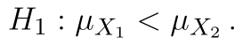
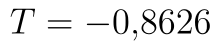
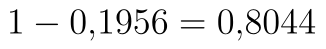
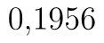
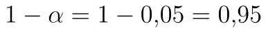
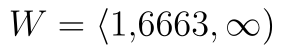

## Dvouvýběrový pravostranný t-test

Nyní si ukážeme postup při pravostranném testu. Upravme si nejprve předchozí zadání: *Máme data o průměrném počtu výrobků, které neprošly kontrolou kvality (tj. zmetků), vyrobených **ve dvou různých závodech**, přičemž druhý závod postupuje podle upravených výrobních procesů. Předpokládáme, že počty mají v obou případech shodný rozptyl. Ověřte hypotézu, že změna výrobních postupů vedla ke snížení zmetkovosti.*

Hypotézy našeho testu jsou následující:

*  (Střední hodnota obou souborů je stejná.)
*  (Střední hodnota prvního souboru je vyšší.)

Statistika testu zůstává stejná, kritický obor se přesunuje doprava, tj.:

::fig[]{src=assets/formula-block-e530792a6a23.png}

::fig[]{src=assets/t-test-dvouvyberovy-pravostranny_dvouvc3bdbc49brovc3bd-t-test-data-pravostrannc3bd1.png}

Soubor se všemi výpočty naleznete [zde](assets/t-test-dvouvyberovy-pravostranny_dvouvyberovy_t-test.xlsx).

## Výpočet s využitím doplňku Analýza dat

Výpočet spustíme pomocí stejného postupu, jako jsme si uvedli výše, tj. označíme oblasti s daty a výstupní oblast. Níže máme výsledek výpočtu. Hodnota statistiky je  a tentokrát máme správně určenou i hranici kritického oboru, kritický obor je tedy

::fig[]{src=assets/formula-block-3f6d66166431.png}

::fig[]{src=assets/t-test-dvouvyberovy-pravostranny_dvouvc3bdbc49brovc3bd-t-test-pravostrannc3bd-analc3bdza-dat.png}

Špatně je ale p-hodnota. Hodnota statistiky je záporná a protože kritický obor určujeme zprava, musí být p-hodnota vyšší než . Dochází zde tedy k problému, který jsme si popisovali výše. Tato p-hodnota by byla **správná v případě levostranného testu**. V případě pravostranného testu je ale .

Porovnání p-hodnot je na grafu níže. Červeně je označena p-hodnota levostranného testu, zeleně p-hodnota pravostranného.

::fig[]{src=assets/t-test-dvouvyberovy-pravostranny_dvouvc3bdbc49brovc3bd-t-test-porovnc3a1nc3ad-p-hodnot1.png}

## Využití funkce T.TEST

Podobně jako Analýza dat, i funkce T.TEST v jednodušší variantě vrací **chybný výsledek**. Pří použití následujícího vzorce

```text
T.TEST(A2:A41;B2:B35;1;2)
```

Python alternativa:

```python
from scipy.stats import ttest_ind

t_stat, p_value = ttest_ind(x, y, equal_var=True, alternative="greater")
```

získáme hodnotu , který by byla správná, pokud bychom dělali levostranný test.

Použijme tedy opět funkci podmínky. Tento vzorec je stejný jako výše s výjimkou znaménka u podmínky, které je obráceně.

```text
=KDYŽ(E3>F3;T.TEST(A2:A41;B2:B35;1;2);1-T.TEST(A2:A41;B2:B35;1;2))
```

Python alternativa:

```python
from scipy.stats import ttest_ind

t_stat, p_value = ttest_ind(x, y, equal_var=True, alternative="greater")
```

## Manuální výpočet

Vzorec pro výpočet statistiky zůstává stejný, proto rovnou přejdeme k dalším krokům.

Kritický obor tentokrát určujeme zprava. Do kritického oboru budou patřit nejvyšší hodnoty z definičního oboru tak, že pravděpodobnost, že testová statistika nabude těchto hodnot, bude přesně , v našem případě . Zbylé hodnoty, u nichž je tato pravděpodobnost , jsou mimo kritický obor. Jak první parametr inverzní distribuční funkce Studentova rozdělení T.INV tedy zadáme , ostatní se nemění:

```text
=T.INV(1-E7;E2+F2-2)
```

Python alternativa:

```python
from scipy.stats import t

critical_value = t.ppf(1 - alpha, df=len(x) + len(y) - 2)
```

Kritický obor je tedy:

.

p-hodnotu určíme pomocí funkce T.DIST a to opět směrem doprava, tj:

```text
=1-T.DIST(E12;E2+F2-2;PRAVDA)
```

Python alternativa:

```python
from scipy.stats import t

p_value = t.sf(t_stat, df=len(x) + len(y) - 2)
```

Můžeme rovněž použít pravostrannou distribuční funkci T.DIST.RT, která nám zápis trochu zjednoduší:

```text
=T.DIST.RT(E12;E2+F2-2)
```

Python alternativa:

```python
from scipy.stats import t

p_value = t.sf(t_stat, df=len(x) + len(y) - 2)
```
