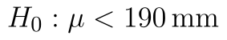
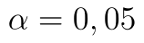

## Levostranný t-test

Poslední možností formulace alternativní hypotézy [t-testu](t-test.md) je levostranný test, kdy v alternativní hypotéze tvrdíme, že soubor má střední hodnotu menší než 190 mm.

Zadání příkladu by bylo obdobou zadání u [z-testu](z-test-levostranny.md) s tím rozdílem, že zde neznáme směrodatnou odchylku dat a musíme ji odhadovat. Při levostranném testu se rozhodujeme mezi těmito hypotézami:

* Nulová hypotéza: Středné hodnota souboru je 190 mm. ()
* Alternativní hypotéza: Střední hodnota souboru je menší než 190 mm. ()

Soubor s daty i výpočty si můžete stáhnout [zde](assets/t-test_t-test.xlsx).

## Výpočet v Excelu

Testová statistika zůstává stejná a ve prospěch alternativní hypotézy mluví její velmi malé hodnoty. Kritický obor tedy "odsekáváme" zleva, tj. kritický obor vyjádřený intervalem má tvar

::fig[]{src=assets/formula-block-323c8e3ade1d.png}

::fig[]{src=assets/t-test-levostranny_t-test-data.png}

Směrodatnou odchylku určíme pomocí funkce

```text
=SMODCH.VÝBĚR.S(A1:A20)
```

Python alternativa:

```python
import numpy as np

sample_std = np.std(sample, ddof=1)
```

Kritický obor má pouze jednu hranici a -tý kvantil t rozdělení. Ten snadno určíme pomocí funkce T.INV:

```text
=T.INV(D6;D2-1)
```

Python alternativa:

```python
from scipy.stats import t

critical_value = t.ppf(alpha, df=n - 1)
```
Kritický obor můžeme vyjádřit intervalem jako

::fig[]{src=assets/formula-block-a965cb391ed7.png}

Vzorec pro výpočet statistiky zůstává stejný jako u [oboustranného testu](t-test.md):

```text
=(D3-D5)/D4*ODMOCNINA(D2)
```

Python alternativa:

```python
import numpy as np

t_stat = (sample.mean() - mu0) / sample_std * np.sqrt(n)
```

Statistika má hodnotu -2,1310. Protože hodnota statistiky leží v kritickém oboru, zamítáme nulovou hypotézu. Na  tedy tvrdíme, že zařízení bylo nastaveno chybně. Zbývá určit p-hodnotu, kterou získáme opět pomocí funkce T.DIST:

```text
=T.DIST(D9;D2-1;PRAVDA)
```

Python alternativa:

```python
from scipy.stats import t

p_value = t.cdf(t_stat, df=n - 1)
```

P-hodnota testu je 0,0232. To potvrzuje závěr o zamítnutí nulový hypotézy na . Nulovou hypotézu bychom nezamítli hladinách významnosti menších než 0,0232.
