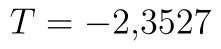

## Párový oboustranný t-test

Zbývá nám poslední varianta testu a tím je oboustranný párový t-test. V případě oboustranného testu řešíme pouze to, jestli se střední hodnoty liší nebo ne. Nerozhodujeme, který ze souborů má menší a který větší střední hodnotu. Vygenerujeme si nový datový soubor, test si ukážeme na .

Hypotézy oboustranného testu jsou:

* 
* 

Statistika testu zůstává stále stejná, kritický obor vyjádřený intervalem je:

::fig[]{src=assets/formula-block-11df788f8f42.png}

### Výpočet s využitím doplňku Analýza dat

Výpočet pomocí Analýzy dat se spouští stejně jako v předchozích případech. Ve výsledcích nás stále zajímá hodnota statistiky, která je nyní . Dále se podíváme na poslední dva řádky, kde vidíme p-hodnotu testu a hranici kritického oboru. Studentovo rozdělení je symetrické a tak víme, že kritický obor je

::fig[]{src=assets/formula-block-64ba346664b2.png}

Na základě p-hodnoty i na základě faktu, že hodnota statistiky se nachází v kritickém oboru, zamítáme nulovou hypotézu.

::fig[]{src=assets/t-test-parovy-oboustranny_parovy-oboustranny-t-test-analyza-dat.png}

### Využití funkce T.TEST (TTEST)

Použití funkce T.TEST je v tomto případě jednoduché. Jako třetí parametr zadáváme číslo 2, které značí oboustranný test. V tomto případě není výpočet komplikovaný 2 variantami testu jako u jednostranných testů a výsledek je vždy správný.

```text
=T.TEST(A2:A21;B2:B21;2;1)
```

Python alternativa:

```python
from scipy.stats import ttest_rel

t_stat, p_value = ttest_rel(x, y, alternative="two-sided")
```

U starší funkce TTEST platí to samé, tj. jako třetí parametr zadáváme dvojku.

```text
=TTEST(A2:A21;B2:B21;2;1)
```

Python alternativa:

```python
from scipy.stats import ttest_rel

t_stat, p_value = ttest_rel(x, y, alternative="two-sided")
```

### Manuální výpočet

Poslední možností je manuální výpočet. Pro určení hranic kritického oboru v novějších verzích Excelu použijeme opět funkce T.INV. Dolní hranici kritického oboru určíme vzorcem

```text
=T.INV(F7/2;F2-1)
```

Python alternativa:

```python
from scipy.stats import t

lower_critical = t.ppf(alpha / 2, df=len(x) - 1)
```

a horní hranici

```text
=T.INV(1-F7/2;F2-1)
```

Python alternativa:

```python
from scipy.stats import t

upper_critical = t.ppf(1 - alpha / 2, df=len(x) - 1)
```

Všimněte si, že použití této funkce je velmi přímočaré, protože použité kvantily odpovídají těm z vzorce pro kritický obor.

P-hodnotu nejsnadněji určíme pomocí funkce T.DIST.2T, což je distribuční funkce oboustranného Studentova rozdělení. Pouze si musíme uvědomit, že **tato funkce je vhodná pouze pro oboustranné testy**. Funkce zadáme hodnotu statistiky (obecně v absolutní hodnotě, protože funkce pracuje jen s kladnými čísly) a získáme p-hodnotu.

```text
=T.DIST.2T(ABS(F13);F2-1)
```

Python alternativa:

```python
from scipy.stats import t

p_value = 2 * t.sf(abs(t_stat), df=len(x) - 1)
```

Pokud bychom chtěli použít klasickou distribuční funkci Studentova rozdělení, pak musíme použít následující vzorec:

```text
=2*MIN(T.DIST(F13;F2-1;PRAVDA);1-T.DIST(F13;F2-1;PRAVDA))
```

Python alternativa:

```python
from scipy.stats import t

p_value = 2 * min(t.cdf(t_stat, df=len(x) - 1), t.sf(t_stat, df=len(x) - 1))
```

::fig[]{src=assets/t-test-parovy-oboustranny_parovy-oboustranny-t-test-data-a-vysledky.png}
