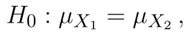
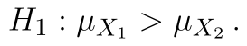
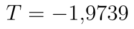
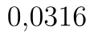
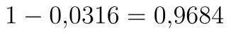

## Párový provostranný t-test

Nyní si na novém datovém souboru stručně popíšeme postup pro pravostranný párový t-test. Opět se budeme pohybovat na hladině významnosti .

Hypotézy pravostranného testu jsou:

* 
* 

Statistika testu zůstává samozřejmě stejná, kritický obor vyjádřený intervalem pak je:

::fig[]{src=assets/formula-block-5a8807bb5676.png}

Soubor s ukázkovými daty i všemi výpočty si [můžete stáhnout zde](assets/t-test-parovy_parovy-t-test.xlsx).

### Výpočet s využitím doplňku Analýza dat

Výpočet pomocí Analýzy dat provádíme stejně jako v předchozím případě. Na obrázku níže vidíme výsledek. Hodnota statistiky testu je . V případě pravostranného testu je kritický obor skutečně napravo od nuly a přesný zápis kritického oboru intervalem by byl

::fig[]{src=assets/formula-block-ca3460e68940.png}

::fig[]{src=assets/t-test-parovy-pravostranny_parovy-pravostranny-t-test-analyza-dat1.png}

V našem případě je však **špatně zobrazená p-hodnota**. Protože statistika pravostranného testu je záporná, p-hodnota musí být větší než . Analýza dat nám zobrazuje p-hodnotu , to by však byla p-hodnota pro případ levostranného testu. P-hodnota pravostranného testu je .

### Využití funkce T.TEST (TTEST)

Podobná záludnost jako výše nás čeká i u funkcí T.TEST a TTEST. Výše už jsme si popsali úpravu, která nám zajistí, že p-hodnota testu bude vždy správná. V případě pravostranného testu stačí malá úprava: **změna znaménka nerovnosti u podmínky**.

```text
=KDYŽ(F12>0;T.TEST(A2:A21;B2:B21;1;1);1-T.TEST(A2:A21;B2:B21;1;1))
```

Python alternativa:

```python
from scipy.stats import ttest_rel

t_stat, p_value = ttest_rel(x, y, alternative="greater")
```

To samé platí pro funkci TTEST.

```text
=KDYŽ(G12>0; TTEST(A2:A21;B2:B21;1;1);1- TTEST(A2:A21;B2:B21;1;1))
```

Python alternativa:

```python
from scipy.stats import ttest_rel

t_stat, p_value = ttest_rel(x, y, alternative="greater")
```

### Manuální výpočet

Paradoxně jednoduše nyní může vypadat manuální výpočet v novějších verzích Excelu. Hranici kritického oboru určíme opět pomocí funkce T.INV, nyní však "odsekáváme" rozdělení statistiky zprava, protože jako kvantil zadáváme :

```text
=T.INV(1-F7;F2-1)
```

Python alternativa:

```python
from scipy.stats import t

critical_value = t.ppf(1 - alpha, df=len(x) - 1)
```

Pro určení p-hodnoty můžeme použít funkci T.DIST.RT, což je pravostranná distribuční funkce Studentova rozdělení:

```text
=T.DIST.RT(F12;F2-1)
```

Python alternativa:

```python
from scipy.stats import t

p_value = t.sf(t_stat, df=len(x) - 1)
```

Použijeme-li nám již známou funkci T.INV, musíme samozřejmě provést odečtení hodnoty od jedničky, abychom získali p-hodnotu:

```text
=1-T.DIST(F12;F2-1;PRAVDA)
```

Python alternativa:

```python
from scipy.stats import t

p_value = t.sf(t_stat, df=len(x) - 1)
```

Ve starších verzích Excelu opět použijeme funkci TINV. Odebereme ale znaménko minus, protože hranice kritického oboru je nyní kladné číslo:

```text
=TINV(2*F7;F2-1)
```

Python alternativa:

```python
from scipy.stats import t

critical_value = t.ppf(1 - alpha, df=len(x) - 1)
```

Pro správné určení p-hodnoty testu opět použijeme funkci KDYŽ, oproti levostrannému testu měníme znaménko nerovnosti v podmínce:

```text
=KDYŽ(H12>0;TDIST(H12;F2-1;1);1-TDIST(-H12;F2-1;1))
```

Python alternativa:

```python
from scipy.stats import t

p_value = t.sf(t_stat, df=len(x) - 1)
```

::fig[]{src=assets/t-test-parovy-pravostranny_parovy-pravostranny-t-test-data-a-vysledky1.png}
