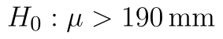

## Pravostranný t-test

Podobně jako u [z-testu](z-test.md) můžeme i u [t-testu](t-test.md) pracovat s pravostrannou variantou testu, kdy formulujeme alternativní hypotézu jako se znaménkem "menší než".

Zadání příkladu by bylo obdobou zadání u [z-testu](z-test-pravostranny.md) s tím rozdílem, že zde neznáme směrodatnou odchylku dat a musíme ji odhadovat. Při pravostranném testu se rozhodujeme mezi těmito hypotézami:

* Nulová hypotéza: Středné hodnota souboru je 190 mm. ()
* Alternativní hypotéza: Střední hodnota souboru je větší než 190 mm. ()

## Výpočet v Excelu

Soubor s daty i výpočty si můžete stáhnout [zde](assets/t-test_t-test.xlsx).

Kritický obor nyní "odsekáváme" zprava, tj. kritický obor vyjádřený intervalem má tvar

::fig[]{src=assets/formula-block-d2c9e5973971.png}

Výpočet statistiky a výběrové směrodatné odchylky zůstává stejný, určíme tedy pouze pouze hranice kritického oboru a p-hodnotu.

::fig[]{src=assets/t-test-pravostranny_t-test-data-a-vysledky.png}

K určení hranice kritického oboru použijeme opět funkci T.INV, tentokrát kritický obor začíná na 95%ním kvantinu t rozdělení, tj. jako první parametr zadávání :

```text
=T.INV(1-D6;D2-1)
```

Python alternativa:

```python
from scipy.stats import t

critical_value = t.ppf(1 - alpha, df=n - 1)
```

Hodnota statistiky je nyní 0,1301. Tato hodnota neleží v kritickém oboru, nulovou hypotézu tedy nezamítáme. K určení p-hodnoty využijeme funkci T.DIST.RT, se kterou jsme se seznámili již výše. Tato funkce vrací plochu pod funkcí hustoty od zadaného bodu směrem doprava.

```text
=T.DIST.RT(D9;D2-1)
```

Python alternativa:

```python
from scipy.stats import t

p_value = t.sf(t_stat, df=n - 1)
```

Alternativně můžeme využít funkci T.DIST. Tato funkce vrací obsah plochy směrem doleva. Protože celková plocha má obsah 1, potřebou hodnotu získáme odečtením výsledku funkce T.DIST od jedničky

```text
=1-T.DIST(D9;D2-1;PRAVDA)
```

Python alternativa:

```python
from scipy.stats import t

p_value = t.sf(t_stat, df=n - 1)
```

P-hodnota testu je 0,4489.
