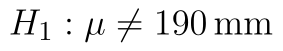
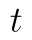
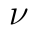
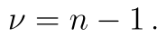
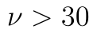
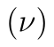
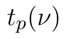
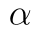
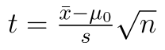

## t-test

Zásadním omezením [z-testu](z-test.md), je nutnost znát rozptyl testovaného souboru. V realitě rozptyl velmi často neznáme, a tak se musíme spokojit s jeho **odhadem**. V takovém případě musíme využít určitou "modifikaci" z-testu, která se nazývá t-test. Ten je používán ke stejnému účelu jako z-test, tedy k ověření hypotézy o střední hodnotě souboru.

Uvažujeme následující příklad: *Máme zařízení, které vyrábí součástku určité délky. Zařízení má určitou chybovost, jejíž přesnou velikost neznáme. Zařízení bylo nastaveno pracovníkem a my chceme ověřit, že pracovník nastavil správnou délku součástky, tj. 190 mm. Pro ověření jsme vybrali a přeměřili náhodný soubor dvaceti součástek.*

Soubor s daty i výpočty si můžete stáhnout [zde](assets/t-test_t-test.xlsx).

Obecné principy testování hypotéz, které jsme si popsali v článku o z-testu, zůstávají v platnosti. Definujeme si tedy nulovou a alternativní hypotézu:

* Nulová hypotéza: Střední hodnota statistického souboru je 190 mm. ()
* Alternativní hypotéza: Střední hodnota statistického souboru je není 190 mm. (.)

Stejně jako u z-testu můžeme u t-testu formulovat [pravostrannou](t-test-pravostranny.md) a [levostrannou](t-test-levostranny.md) variantu.

Statistiku získáme ze vzorce

::fig[]{src=assets/formula-block-6640453d673f.png}

kde  je průměr našeho vzorku,  je teoretická (testovaná) střední hodnota, a  je rozsah náhodného výběru. Proměnná  je odhad rozptylu základního souboru a pro tento odhad využijeme [výběrový rozptyl](rozptyl.md).

Naše statistika  nemá tentokrát normované rozdělení, ale má takzvané **Studentovo** neboli **t rozdělení**. Toto rozdělení má jeden parametr, který značíme . V našem případě platí vztah 

t rozdělení má podobné vlastnosti jako normované normální: jeho **střední hodnota je 0** a je **symetrické kolem 0**. Čím vyšší je hodnota parametru , tím více se distribuční funkce t rozdělení blíží normovanému normálnímu. Často se uvádí, že u t-testu můžeme pro  použít normované normální rozdělení. Pokud však i pro tyto hodnoty použijeme t rozdělení, nejedná se o chybu.

Kvantilvou funkci t rozdělení s  stupni volnosti budeme značit  . Kritický obor testu určíme ze vzorce

::fig[]{src=assets/formula-block-e9b659d80106.png}

kde  značí hladinu významnosti testu.

## Výpočet v Excelu

Nyní již víme vše, co potřebujeme, a můžeme se vrhnout na provedení testu v Excelu.

Náš testovací soubor máme uložený v buňkách A1 až A20. Test provedeme na , tuto hodnotu máme v buňce D6.

::fig[]{src=assets/t-test_t-test-data-2.png}

K provedení t-testu potřebujeme výběrovou směrodatnou odchylku souboru. Směrodatnou odchylku získáme vzorcem

```text
=SMODCH.VÝBĚR.S(A1:A20)
```

Python alternativa:

```python
import numpy as np

sample_std = np.std(sample, ddof=1)
```

Hodnotu si uložíme do buňky D4. Teoretickou střední hodnotu máme v buňce D10, průměr náhodného souboru v buňce D3. Nyní určíme kritický obor. Využijeme kvantilovou funkci Excelu pro t rozdělení - `T.INV`. Dolní hranici kritického oboru získáme vzorcem

```text
=T.INV(D6/2;D2-1)
```

Python alternativa:

```python
from scipy.stats import t

lower_critical = t.ppf(alpha / 2, df=n - 1)
```

a horní hranici vzorcem

```text
=T.INV(1-D6/2;D2-1)
```

Python alternativa:

```python
from scipy.stats import t

upper_critical = t.ppf(1 - alpha / 2, df=n - 1)
```

Důležité je, že funkce T.INV **obsahuje v názvu tečku**. Nepleťte si tuto funkci se starší funkcí TINV, která vrací jiné výsledky.

Hodnoty se liší pouze znaménkem, protože (jak už jsme uvedli) je t rozdělení symetrické kolem 0. Ze získaných hodnot můžeme kritický obor zapsat intervalem:

::fig[]{src=assets/formula-block-53acec661a07.png}

Nyní si určíme hodnotu statistiky (pomocí vzorce ):

```text
=(D3-D5)/D4*ODMOCNINA(D2)
```

Python alternativa:

```python
import numpy as np

t_stat = (sample.mean() - mu0) / sample_std * np.sqrt(n)
```

Hodnota statistiky je -0,92 a výsledek máme v buňce D10. Protože statistika leží mimo kritický obor, **nulovou hypotézu nezamítáme**. Určeme si ještě p-hodnotu testu. K tomu využijeme distribuční funkci t rozdělení T.DIST:

```text
=T.DIST(D10;D2-1;PRAVDA) * 2
```

Python alternativa:

```python
from scipy.stats import t

p_value = 2 * min(t.cdf(t_stat, df=n - 1), t.sf(t_stat, df=n - 1))
```

V tomto případě určujeme p-hodnotu jako plochu pod hustotou statistiky směrem doleva a násobíme ji dvěma. Pokud bychom však měli hodnotu statistiky vyšší než 0, je třeba určovat p-hodnotu jako plochu od statistiky směrem doprava. K tomu můžeme využít funkci `T.DIST.RT`, která určuje kvantily t rozdělení zprava. Správná hodnota bude vždy ta menší.
