## Welchův t-test

Welchův test používáme pro soubory, jejichž pozorování **nejsou spárována a nemůžeme u nich předpokládat shodný rozptyl**. V některých učebnicích statistiky je doporučeno začít s ověřením hypotézy o shodě rozptylů pomocí Fischerova testu a dle výsledku poté zvolit variantu t-testu. Tento postup však není korektní.

Abychom si ještě jednou ukázali odlišnost Welchova testu, vyjdeme ze zadání z předchozích dvou článku: *Máme data o průměrném počtu vyrobených výrobků pracovníky **ve dvou různých závodech**, přičemž v jednom ze závodů jsou testovány nové výrobní procesy. Vedení společnosti potřebuje ověřit, zda nové výrobní postupy zvýšily produktivitu práce. Ověřte na  hypotézu, že v závodě s novými výrobními postupy vyrobí pracovníci v průměru více výrobků, než v závodě s původními postupy, přičemž předpokládáme, že **rozptyly** průměrného počtu výrobků **se mohou lišit**.*

Opět zavedeme značení: 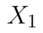 obsahuje pozorování ze závodu se starými postupy a soubor  pozorování ze závodu s upravenými postupy. Příslušné střední hodnoty pak označíme  a . Nyní můžeme formulovat nulovou a alternativní hypotézu:

* Nulová hypotéza: Střední hodnota obou souborů je stejná. ()
* Alternativní hypotéza: Střední hodnota prvního souboru je nižší. (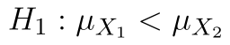)

Statistiku testu vypočteme dle vzorce

::fig[]{src=assets/formula-block-5111c1bfc597.png}

kde 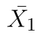 a 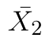 značí průměry, 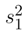 a 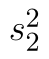 výběrové rozptyly a 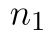 a 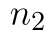 počty pozorování. Statistika má opět Studentovo (t) rozdělení. Poměrně složitý je tentokrát určení počtů stupňů volnosti, proto se ručnímu výpočtu vyhneme a provedeme výpočet pouze pomocí Analýzy dat a funkce T.TEST.

Soubor s daty i výpočty si můžete stáhnout [zde](assets/welchuv-test_welschuv-test.xlsx).

::fig[]{src=assets/welchuv-test_levostranny-welchuv-test-excel.png}

## Výpočet pomocí doplňku Analýza dat

V Analýze dat tentokrát volíme možnost **Dvouvýběrový t-test s nerovností rozptylů**.

::fig[]{src=assets/welchuv-test_vyber_testu.png}

Do polí 1. soubor a 2. soubor vybereme oblasti s daty. Vybereme-li oblasti včetně záhlaví, zaškrtneme pole Popisky. Dále označíme Výstupní oblast a stiskneme tlačítko OK.

::fig[]{src=assets/welchuv-test_levostranny-welchuv-test-ad-vysledky.png}

Na obrázku níže vidíme výsledky.

::fig[]{src=assets/welchuv-test_levostranny-welchuv-test-ad-vysledky-2-1.png}

Protože provádíme levostranný test, zajímají nás označené řádky. Hodnota statistiky je tedy 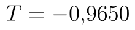. Kritický obor se nachází vlevo, proto vezmeme hranici z řádku t krit (1) a přidáme k ní tlačítko minus. Kritický obor tedy leží v intervalu 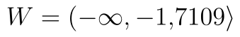. P-hodnota testu je 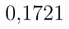. P-hodnota skutečně odpovídá naší variantě testu. Protože p-hodnota je vyšší než hladina významnosti, nezamítáme .

*Poznámka:* Statistika testu je totiž záporná a tím pádem musí být p-hodnota menší než . 

## Výpočet pomocí funkce T.TEST

Funkce `T.TEST` vrací p-hodnotu testu. Prvními dvěma parametry jsou soubory s daty. Třetím parametrem je varianta testu (oboustranný nebo jednostranný), zadáváme tedy 1. Posledním parametrem volíme, zda se jedná o párový t-test (1), Studentův t-test (2) nebo Welchův test (3).

```text
=T.TEST(A2:A21,B2:B18,1,3)
```

Python alternativa:

```python
from scipy.stats import ttest_ind

t_stat, p_value = ttest_ind(x, y, equal_var=False, alternative="less")
```

Pro naše data vrací funkce hodnotu , na základě toho bychom tedy nezamítli .

### Obecná funkce pro levostranný test

Funkce T.TEST funguje na podobném principu jako výpočet p-hodnoty u Analýzy dat, tj. vrací menší z možných dvou p-hodnot. Teoreticky by se mohlo stát, že by hodnota statistiky byla vyšší než 0 a tím pádem by p-hodnota testu byla vyšší 0,5. Funkce T.TEST však vrací vždy p-hodnotu menší než 0,5, tj. vracela by p-hodnotu pro pravostranný test. Rozhodnutí můžeme opět provést na základě hodnoty statistiky a pomocí funkce KDYŽ:

```text
=KDYŽ(E8<0,T.TEST(A2:A21,B2:B18,1,3),1-T.TEST(A2:A21,B2:B18,1,3))
```

Python alternativa:

```python
from scipy.stats import ttest_ind

t_stat, p_value = ttest_ind(x, y, equal_var=False, alternative="less")
```

Samotný vzorec pro výpočet statistiky je 

```text
=(E3-F3)/ODMOCNINA(E4/E2+F4/F2)
```

Python alternativa:

```python
import numpy as np

t_stat = (x.mean() - y.mean()) / np.sqrt(x.var(ddof=1) / len(x) + y.var(ddof=1) / len(y))
```
