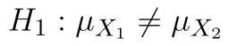
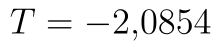
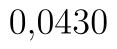
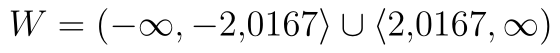

## Welchův oboustranný t-test

V případě oboustranného testu řešíme pouze to, zda je mezi středními hodnotami rozdíl. Vraťme se k našemu příkladu s počty vyrobených výrobků ve dvou různých závodech. Nyní tedy rozhodneme *pouze* o tom, zda se průměrné počty mezi závody *liší*.

Naše hypotézy jsou nyní:

*  (Střední hodnota obou souborů je stejná.)
*  (Střední hodnota prvního souboru je nižší.)

Soubor s daty i výpočty si můžete stáhnout [zde](assets/welchuv-test-oboustranny_welschuv-test.xlsx).

Test opět provedeme na hladině významnosti .

::fig[]{src=assets/welchuv-test-oboustranny_oboustranny-welchuv-test-excel.png}

## Výpočet pomocí doplňku Analýza dat

Test spustíme pomocí stejného postupu jako v ostatních variantách. Hodnota statistiky testu je . p-hodnotu a hranici kritického oboru nyní najdeme v posledních dvou řádcích. p-hodnota testu je . Kritický obor je v případě oboustranného testu rozdělen na dvě části. Analýza dat nám vrací dolní hranici pravé části, horní hranici levé získáme, když před danou hranici napíšeme 0. Kritický obor je tedy .

::fig[]{src=assets/welchuv-test-oboustranny_oboustranny-welchuv-test-ad-vysledky.png}

Statistika tedy leží v kritickém oboru a p-hodnota je nižší než hladina významnosti, na  tedy zamítáme . Tentokrát jsme však pouze prokázali, že mezi výkonností závodů existuje rozdíl, nelze však tvrdit, že v druhém závodě je výkonnost vyšší.

## Výpočet pomocí funkce T.TEST

V případě oboustranného testu zadáváme na třetí pozici číslo 2, díky čemuž nám funkce T.TEST vrátí p-hodnotu oboustranného testu. V našem případě to je tedy hodnota .

```text
=T.TEST(A2:A21,B2:B26,2,3)
```

Python alternativa:

```python
from scipy.stats import ttest_ind

t_stat, p_value = ttest_ind(x, y, equal_var=False, alternative="two-sided")
```

V případě oboustranného testu je vrácená hodnota vždy správná a funkci již nemusíme nijak upravovat.
