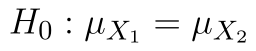
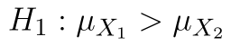
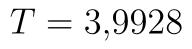
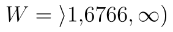
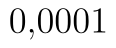
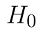

## Welchův pravostranný t-test

Uvažujme nyní, že máme obdobné zadání, máme však data o průměrné době potřebné na výrobu jednoho výrobku. Pokud by technologické postupy v novém závodě byly efektivnější, průměrná doba výroby by měla být nižší. Data jsou v tabulce níže.

Modifikujeme alternativní hypotézu a získáme dvojici hypotéz:

* 
* 

Hladina významnosti je stále .

Soubor s daty i výpočty si můžete stáhnout [zde](assets/welchuv-test-pravostranny_welschuv-test.xlsx).

::fig[]{src=assets/welchuv-test-pravostranny_pravostranny-welchuv-test-excel.png}

### Výpočet pomocí doplňku Analýza dat

Postup výpočtu je naprosto stejný jako u levostranného testu. Pro aktuální data máme výstup na obrázku níže.

::fig[]{src=assets/welchuv-test-pravostranny_pravostranny-welchuv-test-ad-vysledky-2.png}

Hodnota statistiky je nyní . Kritický obor se nachází vpravo, proto hranici najdeme v řádku t krit (1) a tentokrát ji nijak neupravujeme. Kritický obor tedy leží v intervalu . Vidíme, že statistika lež v kritickém oboru. p-hodnota testu je , zamítáme tedy . Na  jsme prokázali, že výroba ve druhém závodě je rychlejší.

## Výpočet pomocí funkce T.TEST

Zápis funkce je opět stejný, tj.:

```text
=T.TEST(A2:A26,B2:B28,1,3)
```

Python alternativa:

```python
from scipy.stats import ttest_ind

t_stat, p_value = ttest_ind(x, y, equal_var=False, alternative="greater")
```

Funkce vrací p-hodnotu testu, což je . Nulovou hypotézu bychom opět zamítli.

Pokud bychom opět chtěli obecný vzorec, který si poradí i s p-hodnotami vyššími než 0,5, upravíme jej o podmínku na základě hodnoty statistiky:

```text
=KDYŽ(E8>0,T.TEST(A2:A26,B2:B28,1,3),1-T.TEST(A2:A26,B2:B28,1,3))
```

Python alternativa:

```python
from scipy.stats import ttest_ind

t_stat, p_value = ttest_ind(x, y, equal_var=False, alternative="greater")
```

Sestavení této podmínky je vyvětlené v [předchozím článku](welchuv-test-dvouvyberovy.md).
