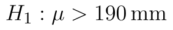
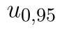

## Pravostranný z-test

Oproti [příkladu s levostranným testem](z-test-levostranny.md) uvažujme nyní opačný případ, tj. kontrolujeme, zda pracovník nastavil **vyšší** délku součástky než 190 mm. Možnost, že by součástky byly kratší, nyní neuvažujeme. Taková varianta testu je označovaná jako pravostranný test.

V případě pravostranného testu máme následující hypotézy:

* Střední hodnota statistického souboru je 190 mm. ()
* Střední hodnota statistického souboru je větší než 190 mm. ()

Kritický obor se nyní nachází vpravo.

::fig[]{src=assets/z-test-pravostranny_kriticke-obory.png}

## Výpočet z-testu v Excelu

Excel soubor s testem je zde: [z-test data](assets/z-test-pravostranny_z-test-data.xlsx).

Budeme opět testovat na . Oproti předchozímu testu máme jinou hranici kritického oboru, která je daná vzorcem

```text
=NORM.S.INV(1-D6)
```

Python alternativa:

```python
from scipy.stats import norm

critical_value = norm.ppf(1 - alpha)
```

Protože normované normální rozdělení je symetrické kolem nuly, je kritická hodnota v absolutní hodnotě stejná jako u předchozí varianty, liší se ale znaménkem.

Kritický obor vyjádřený intervalem má tvar:

::fig[]{src=assets/formula-block-a76669e1d359.png}

kde  označuje 95%ní kvantil normovaného normálního rozdělení. Průběh testu vidíte na obrázku níže. Na  nulovou hypotézu nezamítáme.

::fig[]{src=assets/z-test-pravostranny_capture2.png}
Protože funkce Z.TEST standardně provádí právě pravostranný test, je její použití jednoduché:

```text
=Z.TEST(A1:A20;D5;D4)
```

Python alternativa:

```python
from scipy.stats import norm

z_stat = (sample.mean() - mu0) / sigma * np.sqrt(len(sample))
p_value = norm.sf(z_stat)
```

Další možností je získání výsledku pomocí distribuční funkce normálního rozdělení. p-hodnotu nyní tvoří plocha vpravo od hodnoty statistiky. K získání p-hodnoty tedy odečteme hodnotu distribuční funkce od jedničky.

```text
=1-NORM.S.DIST(D9,PRAVDA)
```

Python alternativa:

```python
from scipy.stats import norm

p_value = norm.sf(z_stat)
```

Výsledek si můžeme zobrazit i graficky.

::fig[]{src=assets/z-test-pravostranny_p-hodnota.png}
Nepodařilo by se nám tedy prokázat, že by byl stroj chybně nastaven.

*Poznámka:* Nyní si ještě jednou ukážeme, proč bychom se měli výroku o pravdivosti nulové hypotézy vyhnout. Jak ukazuje obrázek níže, střední hodnota dat byla ve skutečnosti o něco vyšší než 190 mm, konkrétně 190,05 mm. Takto malou chybu se nám tedy nepodařilo odhalit. 

::fig[]{src=assets/z-test-pravostranny_capture.png}
